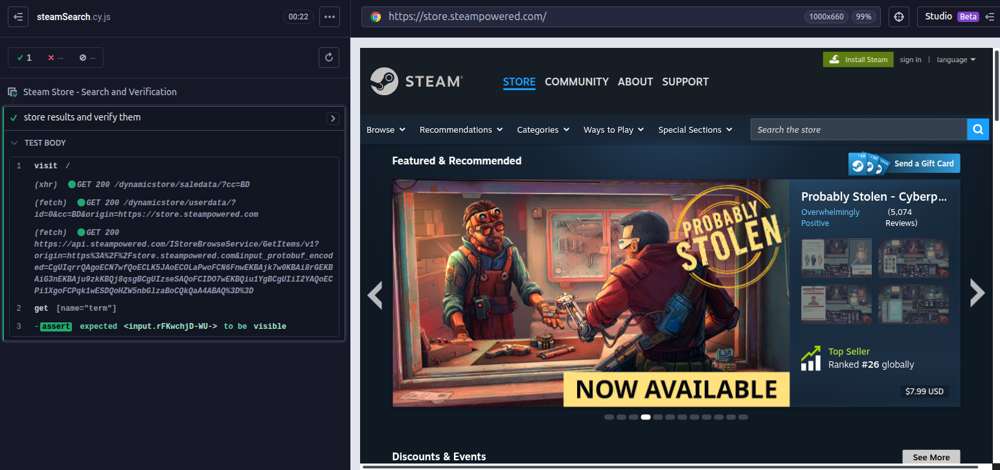
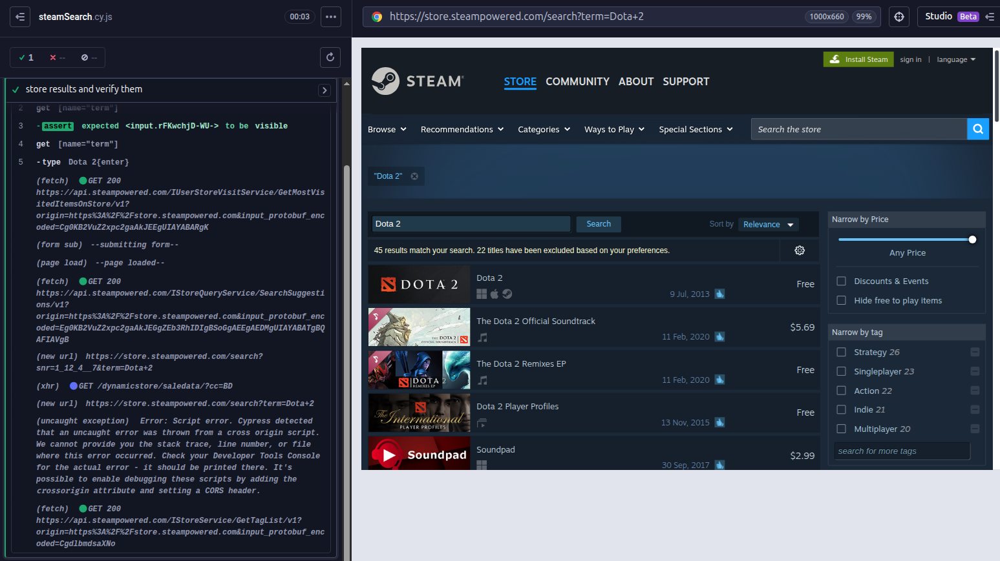
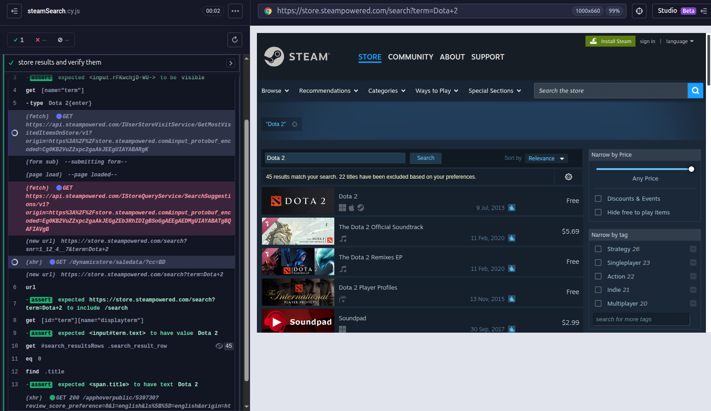
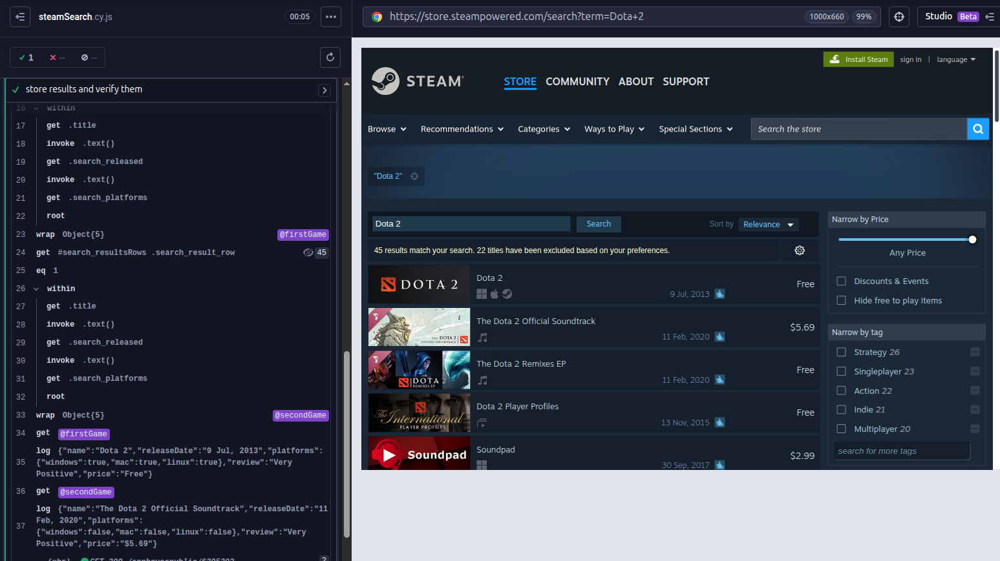
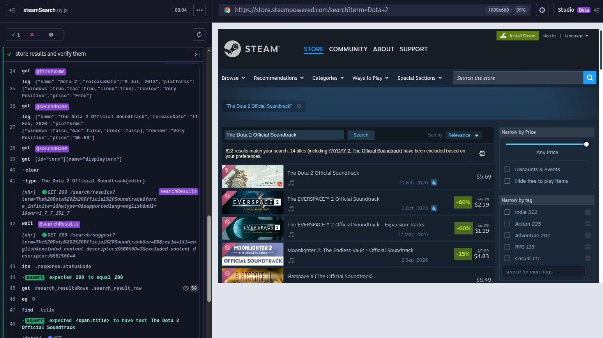
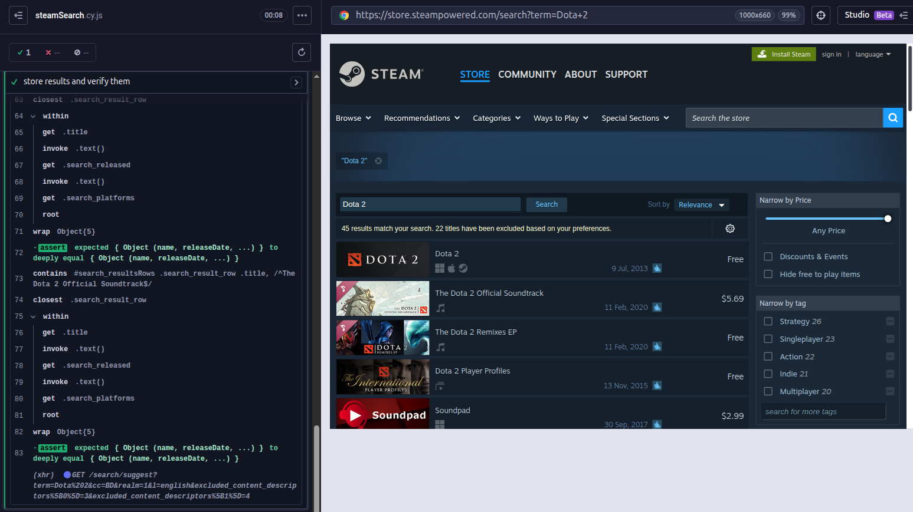
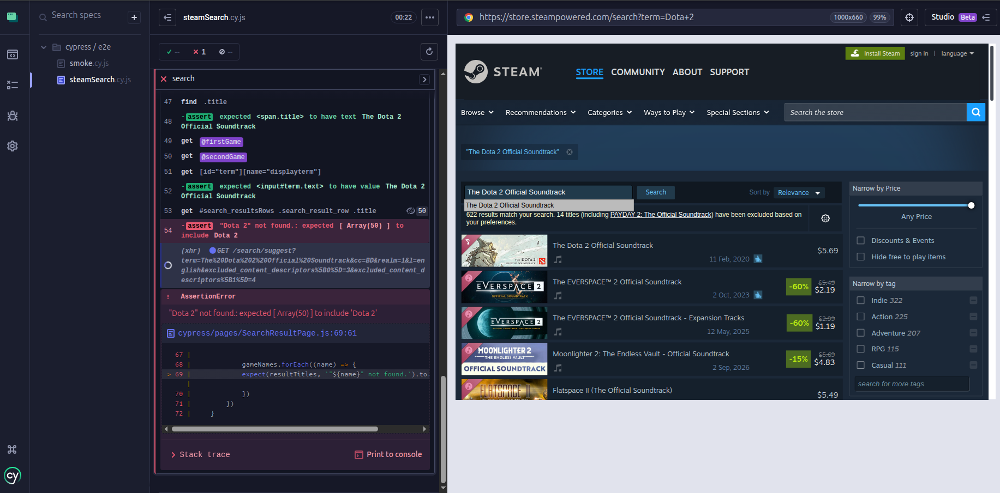

# Steam Store Search & Verification – Cypress Automation

Automated end-to-end test for the **Steam Store** (https://store.steampowered.com) that searches for a game, extracts data from the search results, re-searches using a stored result, and verifies that the stored data matches the live page.

Built with **Cypress** using the **Page Object Model (POM)**.

---

## Tech Stack

| Tool | Version |
|---|---|
| Cypress | **16.3.0** |
| Language | JavaScript |
| Node.js | v24.20.0 |
| Browser | Chrome 154 / Electron |
| OS | Ubuntu Linux |

---

## Project Structure

```
steam-cypress-automation/
├── cypress/
│   ├── e2e/
│   │   └── steamSearch.cy.js        # Test flow (Steps 1–6)
│   ├── pages/
│   │   ├── Homepage.js              # Homepage: visit + navbar search
│   │   └── SearchResultPage.js      # Results page: search box, result rows,
│   │                                #   data extraction, verifications
│   ├── fixtures/
│   └── support/
│       ├── commands.js
│       └── e2e.js
├── docs/
│   └── screenshots/                 # Test execution evidence used in this README
├── cypress.config.js
├── package.json
└── README.md
```

---

## Setup

**Prerequisites:** Node.js (v20 or later) and npm.

On Ubuntu, Cypress also needs a few system libraries:

```bash
# Ubuntu 24.04
sudo apt install -y libgtk2.0-0t64 libgtk-3-0t64 libgbm-dev libnotify-dev libnss3 libxss1 libasound2t64 libxtst6 xauth xvfb

# Ubuntu 22.04
sudo apt install -y libgtk2.0-0 libgtk-3-0 libgbm-dev libnotify-dev libnss3 libxss1 libasound2 libxtst6 xauth xvfb
```

Clone and install:

```bash
git clone https://github.com/Kodarrr/steam-cypress-automation.git
cd steam-cypress-automation
npm install
```

---

## How to Run the Tests

**Interactive mode (Cypress Test Runner):**
```bash
npx cypress open
```
Choose **E2E Testing**, pick a browser, and click `steamSearch.cy.js`.

**Headless mode (terminal):**
```bash
npx cypress run
```

**Headless in Chrome:**
```bash
npx cypress run --browser chrome
```

---

## Test Scenario

| Step | Action | Verification |
|---|---|---|
| 1 | Open the Steam Store homepage | Navbar search box is visible |
| 2 | Search for **"Dota 2"** | — |
| 3 | Results page loads | URL contains `/search`, search box contains "Dota 2", first result is exactly "Dota 2" |
| 4 | Store data for the 1st and 2nd results | Name, platforms, release date, review summary, price |
| 5 | Re-search using the 2nd game's name | Network response is `200`, and the first result is the searched game (confirms the list refreshed) |
| 6 | Re-search with the 1st game's name ([see note](#step-6-final-verification-uses-the-1st-games-name-on-purpose)), then final verification | Search box contains the searched name, result list contains both stored games, all stored fields match exactly |


---

## Design Decisions

**Page Object Model**
Selectors and page actions live in `cypress/pages/`. The test file only describes the flow, so it reads like the assignment steps. If Steam changes a selector, it is fixed in one place.

**Selector strategy**
Steam is a third-party site, so `data-test` attributes could not be added. Selectors were chosen in this order of stability:
1. `id` / `name` / `role` attributes (e.g. `#term`, `input[name="term"][role="combobox"]`)
2. Meaningful, purpose-named classes (e.g. `.search_result_row`, `.title`, `.search_released`)

Auto-generated hashed classes (e.g. `rFKwchjD-WU-`) and full multi-class strings were avoided, since they change between Steam deployments.

**Row-first extraction**
Data is extracted by first locking onto one result row and then reading fields inside it with `.within()`. This guarantees all five fields belong to the same game. Indexing each field list separately could silently mix data from different games if one row is missing a field.

**Optional fields**
Review summary and price are not present for every result. These are read with jQuery (`$row.find(...)`) instead of `cy.get()`, so a missing element is handled (`"No Reviews"` / `"N/A"`) instead of failing the test.

**Platforms**
Platform support is shown only as icons with no text, so it is detected by the presence of the `.win`, `.mac`, and `.linux` classes.

**Exact name matching**
In Step 6, rows are found by name using an anchored regex (`^name$`). A plain text match for "Dota 2" would also match "The Dota 2 Official Soundtrack".

**No hard-coded waits**
There is no `cy.wait(<number>)` anywhere. The test relies on Cypress's built-in retrying, and the results-page search waits on the actual network request:

```javascript
cy.intercept('GET', '/search/results*').as('searchResults')
// ...type and submit...
cy.wait('@searchResults').its('response.statusCode').should('eq', 200)
```

**Avoiding stale results**
The first search's results already contain the 2nd game. To make sure Step 6 checks the *new* list, Step 5 asserts that the first result is now the searched game before continuing.

**Sticky header**
Steam's sticky navbar covered the results-page search box when Cypress scrolled it to the top of the viewport. This was fixed with `scrollBehavior: 'center'` in `cypress.config.js`, instead of using `{ force: true }`, which would hide real visibility problems.

---

## Step-by-Step Execution

Each screenshot shows the Cypress command log (left) and the live Steam page (right).

### Step 1: Open the Steam Store homepage

`homepage.visit()` opens `/` and asserts the navbar search input (`[name="term"]`) is visible.



### Step 2: Search for "Dota 2"

`homepage.search("Dota 2")` types the term into the navbar search and presses Enter. The browser navigates to `/search?term=Dota+2`.



### Step 3: Verify the results page

Three assertions pass:
- URL contains `/search`
- search box value is `Dota 2`
- first result title is exactly `Dota 2`



### Step 4: Store the 1st and 2nd results

Each row is read with `.within()` and saved as an object under the aliases `@firstGame` and `@secondGame`. Both objects are logged:

| Field | `@firstGame` | `@secondGame` |
|---|---|---|
| Name | Dota 2 | The Dota 2 Official Soundtrack |
| Release date | 9 Jul, 2013 | 11 Feb, 2020 |
| Platforms | Windows, macOS, Linux | none |
| Review | Very Positive | Very Positive |
| Price | Free | $5.69 |

### Extracted data format

Each result is stored as an object and kept as a Cypress alias (`@firstGame`, `@secondGame`) for re-use in Step 6:

```json
{
  "name": "Dota 2",
  "releaseDate": "9 Jul, 2013",
  "platforms": { "windows": true, "mac": true, "linux": true },
  "review": "Very Positive",
  "price": "Free"
}
```



### Step 5: Re-search using the 2nd game's name

The results-page search box is cleared, and "The Dota 2 Official Soundtrack" is submitted. The test waits for `GET /search/results*` to return `200`, then asserts that the first result is the searched game.



### Step 6: Final verification (uses the 1st game's name, on purpose)

> **Note:** Step 6 re-searches with the **first** game's name ("Dota 2") **on purpose**, so the test can pass.
>
> On the live site, the 2nd game's search ("The Dota 2 Official Soundtrack") does not return "Dota 2" among its 50 loaded results. With the 2nd name, Step 6.2 fails with:
>
> `"Dota 2" not found.: expected [ Array(50) ] to include 'Dota 2'`
>
> The 2nd-name search-box check is left as a commented-out line in [`steamSearch.cy.js`](cypress/e2e/steamSearch.cy.js).

After searching "Dota 2", the test verifies:
1. The search box contains the searched name.
2. The result list contains both stored games.
3. Each stored game's row is found by exact name, its data is re-extracted, and the result is `deep.equal` to the stored object (name, platforms, release date, review, price).



<details>
<summary>Failure when Step 6 uses the 2nd game's name</summary>



</details>
